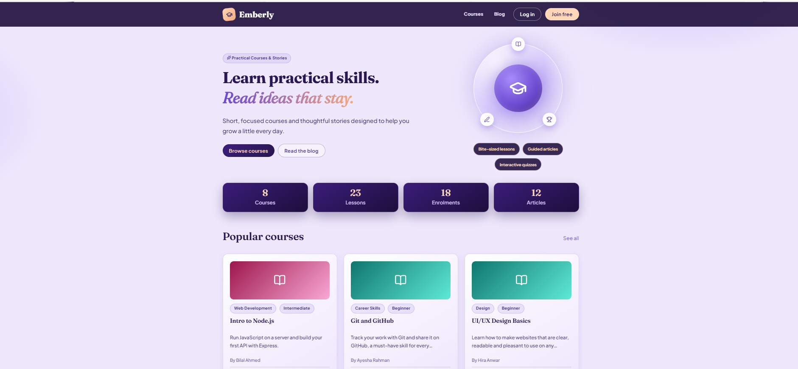
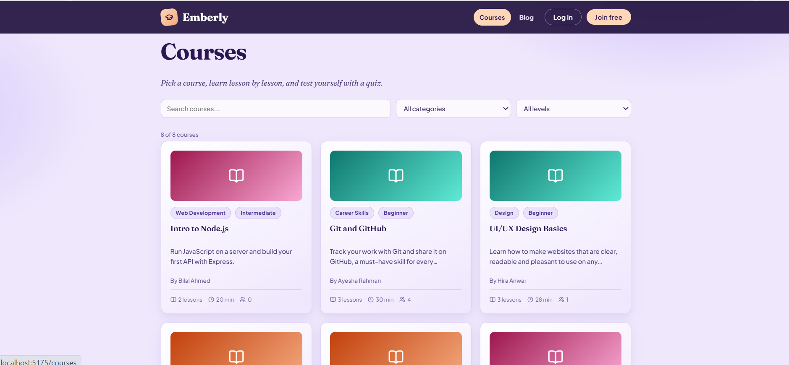
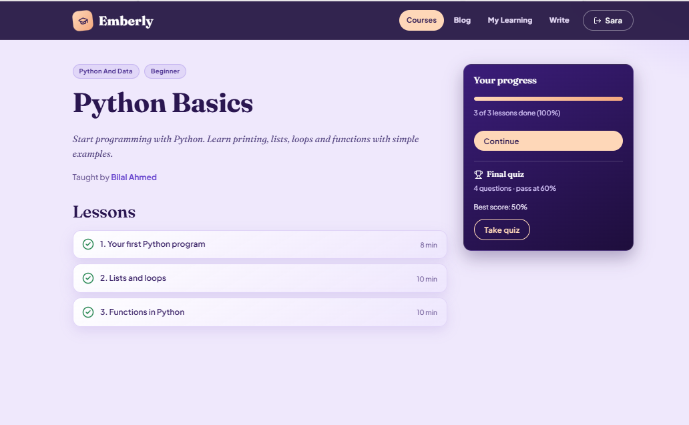
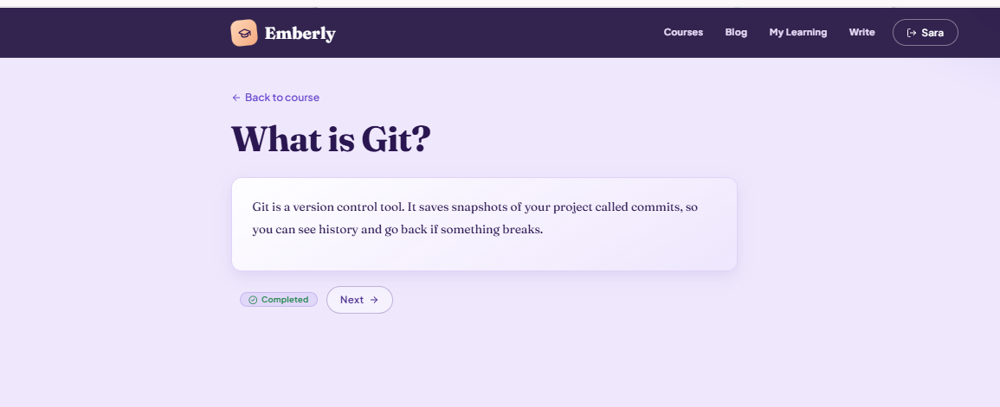
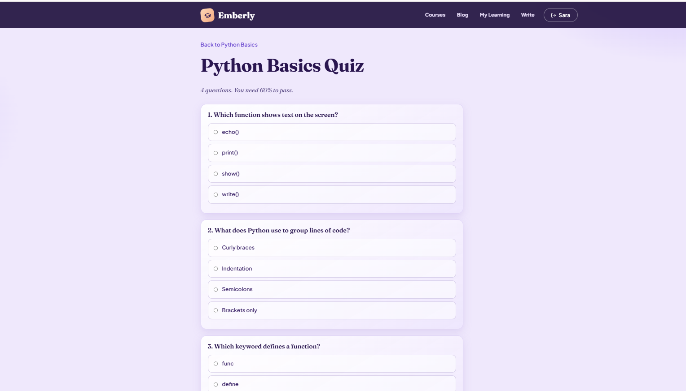
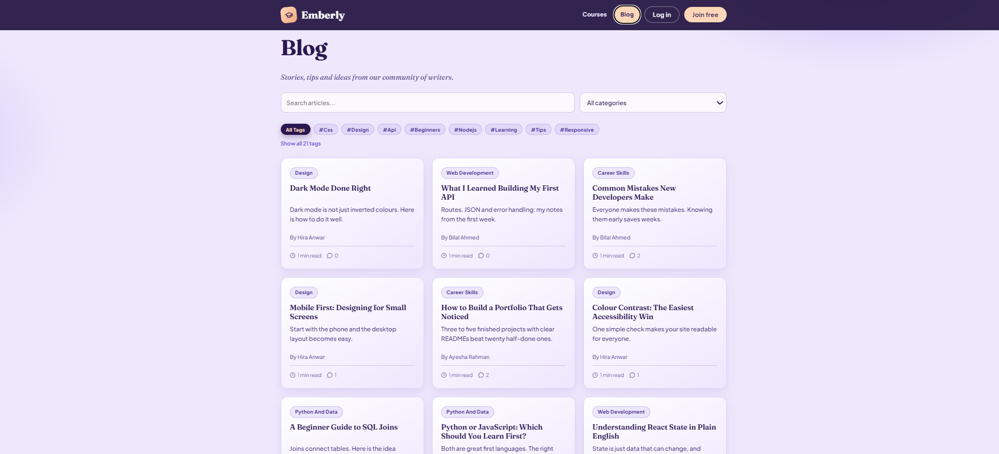
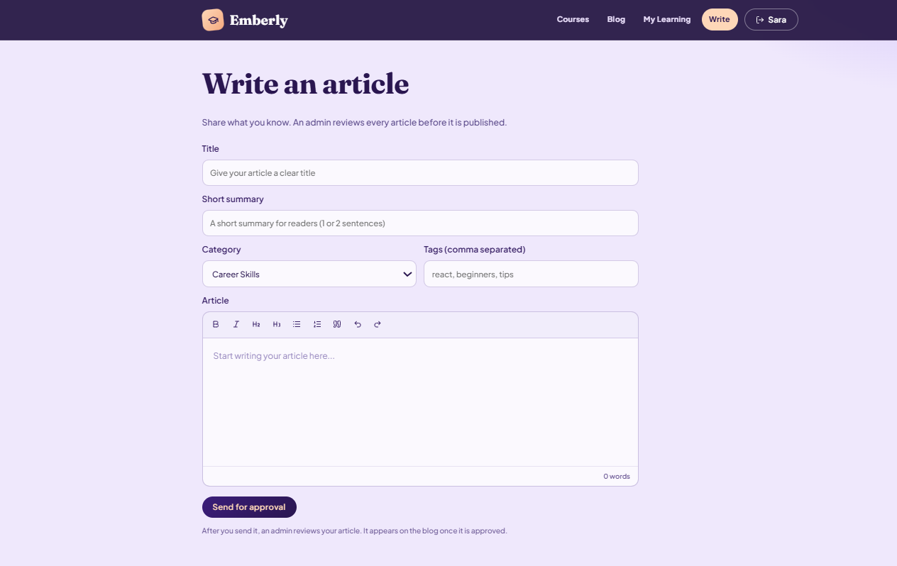
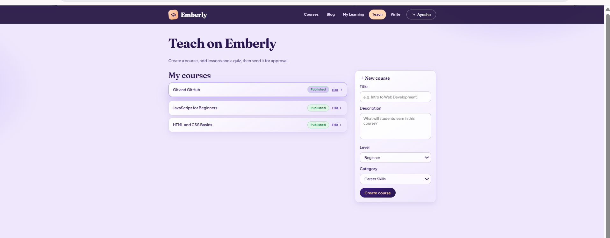
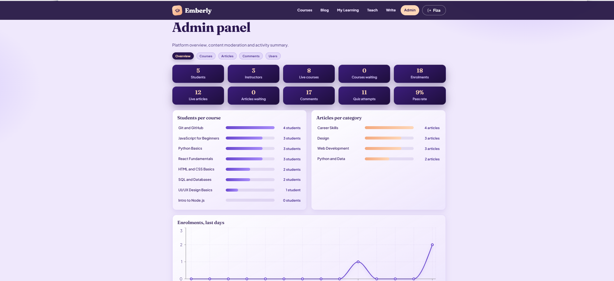

# Emberly

Emberly is a small learning site I built for my Codneura internship (Project 5). Students can take short courses and read articles, instructors can create courses, and an admin checks everything before it goes live.

**Built by:** Fiza Saleem
**Email:** fiza.cm26.9214@gmail.com
**GitHub:** https://github.com/Fiza-insights

## What you can do on the site

- Browse courses, enrol, read lessons and mark them complete. Your progress is saved.
- Take a quiz at the end of a course and see your score with explanations.
- Read articles, search them, filter by category or tag, like and save them, and leave comments.
- Write your own article with a rich text editor. It appears on the blog once an admin approves it.
- As an instructor, create a course, add lessons, build a quiz and send it for approval.
- As an admin, see a dashboard with charts, approve or reject courses, articles and comments, and change user roles.

## What I used

- **Frontend:** React 18 with Vite, React Router, Recharts for the charts, TipTap for the editor, Lucide for icons. The styling is plain CSS.
- **Backend:** Node.js with Express 5.
- **Database:** SQLite through better-sqlite3.
- **Security:** passwords are hashed with bcryptjs, login uses JWT, and article HTML is cleaned with sanitize-html.

## How to run it

You need Node.js 18 or newer.

```bash
git clone https://github.com/Fiza-insights/Educational-Blog-Portal.git
cd Educational-Blog-Portal
```

Start the backend (runs on port 5002):

```bash
cd backend
npm install
copy .env.example .env
node seed.js
node seed-courses-1.js
node seed-courses-2.js
node seed-posts.js
node server.js
```

Then, in a second terminal, start the frontend (runs on port 5175):

```bash
cd frontend
npm install
npm run dev
```

Open http://localhost:5175 in your browser. The frontend sends `/api` requests to the backend on port 5002.

The database file is created on its own the first time the backend starts. If you want to look at the raw SQL, it is in the `database` folder: `schema.sql` for the tables and `seed.sql` for the demo data.

## Demo logins

| Role | Email | Password |
|------|-------|----------|
| Admin | admin@emberly.test | Admin@123 |
| Instructor | instructor1@emberly.test | Instructor@123 |
| Student | student@emberly.test | Student@123 |

There are a few more students too: ali, maham, usman and zoya (all `@emberly.test`, password `Student@123`).

## Screenshots

| | |
|---|---|
| **Home**<br> | **Courses**<br> |
| **Course page**<br> | **Lesson**<br> |
| **Quiz result**<br> | **Blog**<br> |
| **Write an article**<br> | **Teach (instructor)**<br> |
| **Admin dashboard**<br> | |
## Credits

- Icons are from [Lucide](https://lucide.dev).
- Fonts are Fraunces and Plus Jakarta Sans from Google Fonts.
- I did not use any stock photos. The course images are CSS gradients with icons.
- All the courses and articles are demo content that I wrote for this project.


